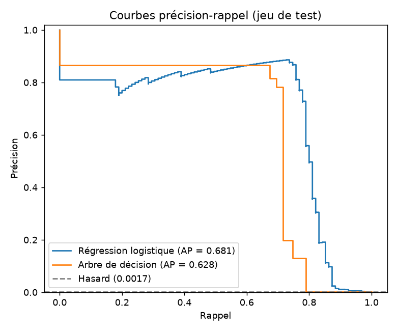
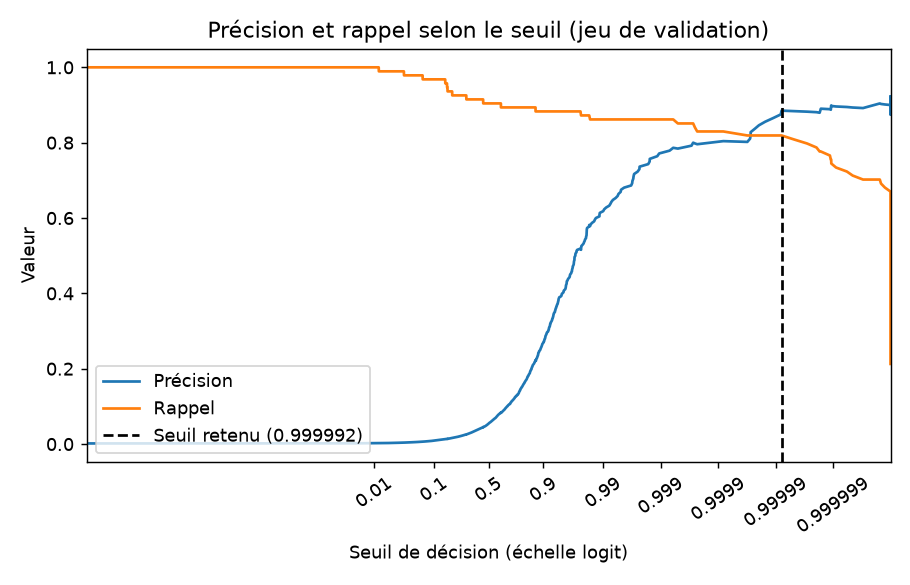

# 2. Évaluation du modèle et analyse des erreurs

Les chiffres de ce rapport proviennent de `reports/results/evaluation.json`, produit par `python -m app.cli train` avec la graine 42.

## 2.1 Protocole

Le fichier `creditcard.csv` contient 284 807 transactions, dont 492 fraudes. Après validation, les 1 081 doublons exacts (dont 19 fraudes) sont supprimés avant le découpage, afin qu'une même transaction ne puisse pas se trouver à la fois dans l'entraînement et dans le test. Il reste 283 726 transactions, dont 473 fraudes, réparties de façon stratifiée :

| Partition | Transactions | Fraudes | Taux |
|---|---|---|---|
| Entraînement (60 %) | 170 235 | 284 | 0,167 % |
| Validation (20 %) | 56 745 | 94 | 0,166 % |
| Test (20 %) | 56 746 | 95 | 0,167 % |

Pour chaque modèle, les hyperparamètres sont choisis d'après la PR-AUC de validation, à partir d'une petite grille. Le seuil de décision est ensuite fixé sur la validation : c'est le seuil qui donne la meilleure précision parmi ceux qui assurent un rappel d'au moins 0,80. Le modèle retenu est celui qui respecte les critères sur la validation avec la meilleure PR-AUC. Il est alors sauvegardé avec son empreinte SHA-256, puis rechargé et évalué une seule fois sur le test.

Les deux modèles utilisent `class_weight="balanced"` pour tenir compte du déséquilibre des classes. Le prétraitement fait partie du pipeline et n'est ajusté que sur l'entraînement.

## 2.2 Comparaison des modèles

| Modèle | Jeu | Accuracy | Précision | Rappel | F1 | FPR | ROC-AUC | PR-AUC | TP | FP | FN |
|---|---|---|---|---|---|---|---|---|---|---|---|
| Référence naïve (toujours « normale ») | val | 0,9983 | 0 | 0 | 0 | 0 | 0,500 | 0,0017 | 0 | 0 | 94 |
| Régression logistique (C = 0,01) | entraînement | 0,9994 | 0,858 | 0,746 | 0,799 | 0,021 % | 0,991 | 0,728 | 212 | 35 | 72 |
| | val | 0,9995 | 0,885 | 0,819 | 0,851 | 0,018 % | 0,980 | 0,791 | 77 | 10 | 17 |
| | test | 0,9994 | 0,875 | 0,737 | 0,800 | 0,018 % | 0,961 | 0,681 | 70 | 10 | 25 |
| Arbre de décision (profondeur 8, 20 observations min. par feuille) | entraînement | 0,9913 | 0,161 | 1,000 | 0,277 | 0,87 % | 0,999 | 0,759 | 284 | 1 482 | 0 |
| | val | 0,9912 | 0,140 | 0,840 | 0,239 | 0,86 % | 0,919 | 0,695 | 79 | 487 | 15 |
| | test | 0,9908 | 0,130 | 0,789 | 0,223 | 0,89 % | 0,893 | 0,628 | 75 | 503 | 20 |

Seuils retenus sur la validation : 0,999992 pour la régression logistique, 0,948 pour l'arbre.

Sur la validation, seule la régression logistique respecte tous les critères. L'arbre est écarté à cause de sa précision (0,140 pour un minimum de 0,30) et de son FPR (0,86 % pour un maximum de 0,5 %). La régression logistique a donc été retenue avant toute utilisation du test. Les résultats de l'arbre sur le test sont donnés pour information et n'ont servi à aucun choix.

## 2.3 Matrices de confusion sur le test

| Régression logistique (retenue) | Arbre de décision |
|---|---|
|  |  |

Pour la régression logistique, on compte 70 fraudes détectées (TP), 25 fraudes manquées (FN), 10 transactions légitimes signalées à tort (FP) et 56 641 transactions normales correctement laissées passer (TN). L'arbre détecte un peu plus de fraudes (75), mais au prix de 503 fausses alertes, ce qui le rend inutilisable en l'état.

## 2.4 Courbes ROC et précision-rappel

| ROC | Précision-rappel |
|---|---|
|  |  |

Les deux modèles obtiennent une ROC-AUC élevée (0,96 et 0,89). Cette mesure est peu discriminante ici, car le FPR rapporte les fausses alertes à 56 651 transactions normales : les 503 fausses alertes de l'arbre ne représentent que 0,9 % de FPR. La courbe précision-rappel est plus parlante. Elle montre que la précision de la régression logistique chute au-delà d'environ 80 % de rappel, et celle de l'arbre au-delà d'environ 70 %. Pour cette raison, la PR-AUC a été choisie comme métrique de sélection.

## 2.5 Limite de l'accuracy

Avec 0,166 % de fraudes, un modèle qui classe toutes les transactions comme normales atteint 99,83 % d'accuracy sans détecter aucune fraude. Les trois modèles du tableau ont tous une accuracy comprise entre 99,1 % et 99,95 %, alors que l'arbre produit cinquante fois plus de fausses alertes que la régression logistique. L'accuracy reflète surtout la classe majoritaire et ne renseigne ni sur les fraudes manquées ni sur les fausses alertes. Le test `test_accuracy_is_misleading_on_imbalanced_data` illustre ce cas.

## 2.6 Choix du seuil

Valeurs mesurées sur la validation pour la régression logistique :

| Seuil | Précision | Rappel | FPR | Alertes | FP | FN |
|---|---|---|---|---|---|---|
| 0,5 (valeur par défaut) | 0,054 | 0,904 | 2,61 % | 1 564 | 1 479 | 9 |
| 0,9 | 0,269 | 0,883 | 0,40 % | 308 | 225 | 11 |
| 0,99 | 0,618 | 0,862 | 0,088 % | 131 | 50 | 13 |
| 0,999 | 0,779 | 0,862 | 0,041 % | 104 | 23 | 13 |
| 0,999992 (retenu) | 0,885 | 0,819 | 0,018 % | 87 | 10 | 17 |

La pondération des classes décale fortement les probabilités vers 1. Avec le seuil par défaut de 0,5, on obtiendrait 1 479 fausses alertes pour 85 fraudes détectées. Le seuil doit donc être réglé, et sa valeur ne doit pas être lue comme une probabilité calibrée.

Entre 0,999 et 0,999992, on supprime 13 fausses alertes mais on manque 4 fraudes de plus. Le seuil retenu se trouve à l'endroit où le rappel commence à baisser, ce qui le rend sensible aux variations d'échantillon (voir 2.8).

## 2.7 Analyse des faux positifs et des faux négatifs

| Cellule | Nombre | Montant médian | Montant moyen | Montant total | Score médian |
|---|---|---|---|---|---|
| TP | 70 | 31,99 | 152,21 | 10 654,78 | ≈ 1,0 |
| FN | 25 | 3,76 | 164,46 | 4 111,53 | 0,69 |
| FP | 10 | 89,99 | 2 836,01 | 28 360,09 | ≈ 1,0 |
| TN | 56 641 | 21,58 | 88,22 | — | 0,023 |

Les fraudes manquées portent surtout sur de très petits montants : la médiane est de 3,76, contre 31,99 pour les fraudes détectées. Ce profil ressemble à des transactions de test de carte, qui précèdent souvent une fraude plus importante. Sur les 25 fraudes manquées, 18 ont un score compris entre 0,1 et le seuil, et 7 ont un score inférieur à 0,1. En montant, le modèle intercepte 72 % de la valeur frauduleuse (10 654,78 sur 14 766,31).

Les 10 fausses alertes ont toutes un score supérieur à 0,99. Leur montant moyen est élevé (2 836), à cause de quelques transactions importantes. Un blocage à tort aurait donc un coût élevé pour le client, ce qui justifie une revue humaine des alertes plutôt qu'un blocage automatique.

Le test correspond à environ 0,4 jour de transactions, soit à peu près 141 900 transactions par jour. Au seuil retenu, on peut en déduire environ 200 alertes par jour, dont 25 fausses, et environ 60 fraudes manquées par jour.

## 2.8 Critères d'acceptation sur le test

| Critère | Seuil | Valeur sur le test | IC 95 % (bootstrap stratifié, 1 000 tirages) | Résultat |
|---|---|---|---|---|
| Rappel | ≥ 0,75 | 0,737 | [0,653 ; 0,832] | non conforme |
| Précision | ≥ 0,30 | 0,875 | [0,802 ; 0,938] | conforme |
| FPR | ≤ 0,5 % | 0,018 % | [0,009 % ; 0,030 %] | conforme |
| PR-AUC | ≥ 0,60 | 0,681 | [0,574 ; 0,786] | conforme (borne basse < 0,60) |
| ROC-AUC | ≥ 0,90 | 0,961 | — | conforme |
| Écart de PR-AUC entre entraînement et test | ≤ 0,10 | 0,047 | — | conforme |

Le critère de rappel n'est pas atteint : 70 fraudes détectées sur 95, alors qu'il en faudrait 72. Comme prévu par le protocole, le seuil et les critères n'ont pas été modifiés après cette observation.

Trois éléments permettent d'interpréter ce résultat. D'abord, l'incertitude est importante : avec 95 fraudes, l'intervalle de confiance du rappel s'étend sur 18 points et contient 0,75, donc le test ne permet de conclure ni dans un sens ni dans l'autre. Ensuite, le rappel de validation (0,819) était favorable : au même seuil, le rappel n'est que de 0,746 sur l'entraînement, et la PR-AUC de validation (0,791) dépasse celle de l'entraînement (0,728). La marge de cinq points prévue lors du choix du seuil n'a pas suffi. Enfin, le seuil se situe dans la zone où le rappel commence à baisser (2.6), si bien qu'un petit changement d'échantillon modifie sensiblement le rappel obtenu.

L'arbre de décision est rejeté. Sa précision est de 0,130 et son FPR de 0,89 %. Il surapprend : son rappel est de 1,000 sur l'entraînement, et sa PR-AUC passe de 0,759 sur l'entraînement à 0,628 sur le test, soit un écart de 0,13, supérieur à la limite de 0,10.

## 2.9 Conclusion

La régression logistique est le meilleur des deux modèles testés. Elle sépare bien les classes (ROC-AUC 0,96, PR-AUC 0,68 contre 0,0017 pour le hasard) et produit peu de fausses alertes (précision 0,875, FPR 0,018 %). En revanche, son rappel n'atteint pas 0,75 sur des données indépendantes, et son seuil est placé dans une zone instable. Les actions correctives sont présentées dans le rapport de qualification (`08_rapport_qualification.md`). Elles devront être vérifiées sur des données nouvelles, puisque le jeu de test actuel a déjà été utilisé.
