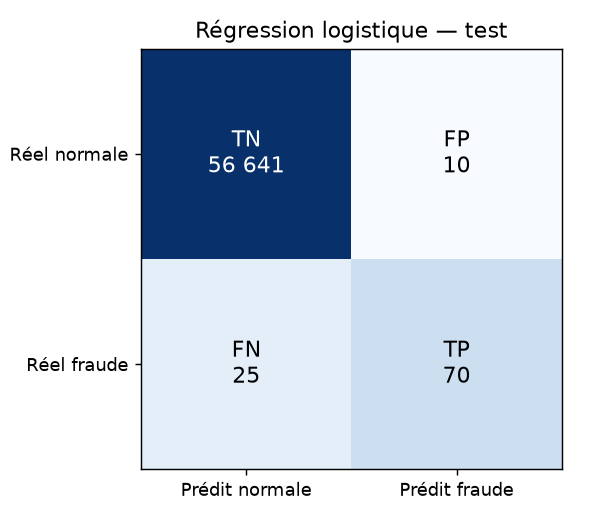
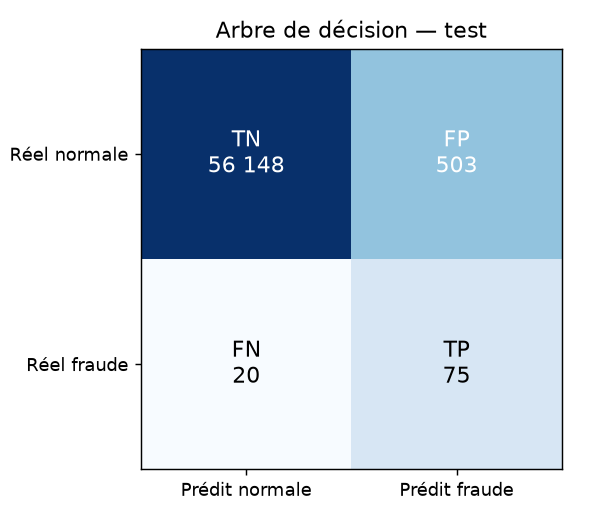
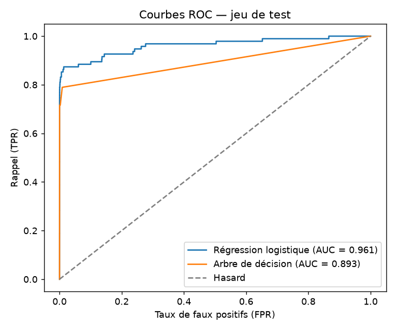
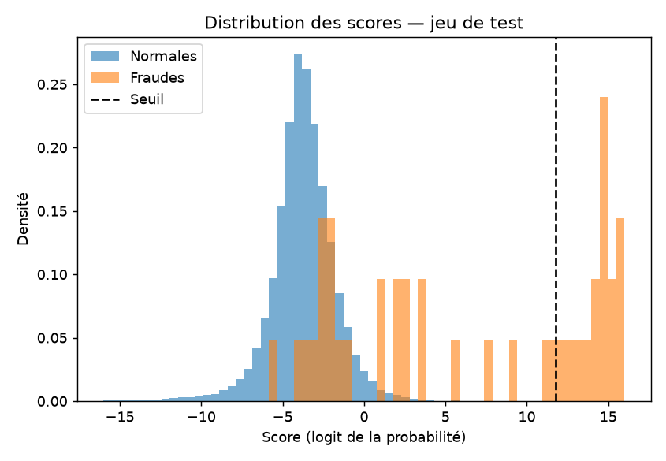

# 2. Évaluation du modèle et analyse des erreurs

> Source des chiffres : `reports/results/evaluation.json`, produit par `python -m app.cli train` (graine 42).

## 2.1 Protocole

1. **Chargement et validation** de `creditcard.csv` : 284 807 transactions, dont 492 fraudes.
2. **Suppression des 1 081 doublons exacts** (dont 19 fraudes) *avant* le découpage, sinon une même transaction pourrait figurer à la fois dans le jeu d'entraînement et dans celui de test (voir T10). Il reste 283 726 transactions, dont 473 fraudes.
3. **Découpage stratifié** 60 / 20 / 20 :

   | Partition | Transactions | Fraudes | Taux |
   |---|---|---|---|
   | Entraînement | 170 235 | 284 | 0,167 % |
   | Validation | 56 745 | 94 | 0,166 % |
   | Test | 56 746 | 95 | 0,167 % |

4. **Réglage des hyperparamètres** sur la PR-AUC de *validation*, avec une petite grille par modèle.
5. **Seuil de décision** choisi sur la *validation* : précision maximale parmi les seuils qui donnent un rappel ≥ 0,80.
6. **Sélection** sur la *validation* : le modèle doit respecter les critères, puis avoir la meilleure PR-AUC.
7. **Gel** du modèle (sauvegarde avec empreinte SHA-256), **puis une seule évaluation sur le test**, après rechargement.

Les deux modèles utilisent `class_weight="balanced"` pour compenser le déséquilibre des classes. Le prétraitement fait partie du pipeline : il est ajusté sur l'entraînement uniquement.

## 2.2 Tableau comparatif

| Modèle | Jeu | Accuracy | Précision | Rappel | F1 | FPR | ROC-AUC | PR-AUC | TP | FP | FN |
|---|---|---|---|---|---|---|---|---|---|---|---|
| Référence naïve (toujours « normale ») | val | **0,9983** | 0 | **0** | 0 | 0 | 0,500 | 0,0017 | 0 | 0 | 94 |
| Régression logistique (C = 0,01) | entraînement | 0,9994 | 0,858 | 0,746 | 0,799 | 0,021 % | 0,991 | 0,728 | 212 | 35 | 72 |
| | val | 0,9995 | 0,885 | 0,819 | 0,851 | 0,018 % | 0,980 | 0,791 | 77 | 10 | 17 |
| | **test** | **0,9994** | **0,875** | **0,737** | **0,800** | **0,018 %** | **0,961** | **0,681** | **70** | **10** | **25** |
| Arbre de décision (profondeur 8, ≥ 20 obs./feuille) | entraînement | 0,9913 | 0,161 | 1,000 | 0,277 | 0,87 % | 0,999 | 0,759 | 284 | 1 482 | 0 |
| | val | 0,9912 | 0,140 | 0,840 | 0,239 | 0,86 % | 0,919 | 0,695 | 79 | 487 | 15 |
| | test | 0,9908 | 0,130 | 0,789 | 0,223 | 0,89 % | 0,893 | 0,628 | 75 | 503 | 20 |

Seuils retenus sur la validation : **0,999992** pour la régression logistique, 0,948 pour l'arbre.

**Sélection.** Seule la régression logistique respecte tous les critères sur la validation. L'arbre échoue sur la précision (0,140 < 0,30) et le FPR (0,86 % > 0,5 %). La régression logistique est donc retenue *avant* toute consultation du test. Les résultats de l'arbre sur le test sont donnés à titre d'information : ils n'ont servi à aucun choix.

## 2.3 Matrices de confusion (test)

| Régression logistique (retenue) | Arbre de décision |
|---|---|
|  |  |

- **TP = 70** : fraudes détectées.
- **FN = 25** : fraudes manquées, soit des pertes financières.
- **FP = 10** : clients légitimes bloqués à tort, d'où des réclamations.
- **TN = 56 641** : transactions normales laissées passer.

À rappel comparable, l'arbre génère **503 fausses alertes contre 10** : il est inexploitable en l'état.

## 2.4 Courbes ROC et précision-rappel (test)

| ROC | Précision-rappel |
|---|---|
|  |  |

La courbe ROC est flatteuse pour les deux modèles (0,96 et 0,89). Elle s'appuie sur le FPR, dont le dénominateur (56 651 transactions normales) écrase les erreurs : 503 fausses alertes ne représentent que 0,9 % de FPR. La courbe précision-rappel est beaucoup plus informative ici. Elle montre que la précision de la régression logistique s'effondre au-delà d'environ 80 % de rappel, et celle de l'arbre au-delà d'environ 70 %. **La PR-AUC est la métrique de référence pour ce problème.**

## 2.5 Pourquoi l'accuracy est trompeuse

Avec 0,166 % de fraudes, un modèle qui répond toujours « normale » obtient **99,83 % d'accuracy en ne détectant aucune fraude** (première ligne du tableau). Les trois modèles ont tous une accuracy entre 99,1 % et 99,95 %, alors que l'arbre produit 50 fois plus de fausses alertes que la régression logistique. L'accuracy est dominée par la classe majoritaire. Elle ne dit rien de ce qui compte ici : les fraudes manquées (FN) et les fausses alertes (FP). Le test `test_accuracy_is_misleading_on_imbalanced_data` documente ce piège.

## 2.6 Compromis lié au seuil (validation)

| Seuil | Précision | Rappel | FPR | Alertes | FP | FN |
|---|---|---|---|---|---|---|
| 0,5 (défaut) | 0,054 | 0,904 | 2,61 % | 1 564 | 1 479 | 9 |
| 0,9 | 0,269 | 0,883 | 0,40 % | 308 | 225 | 11 |
| 0,99 | 0,618 | 0,862 | 0,088 % | 131 | 50 | 13 |
| 0,999 | 0,779 | 0,862 | 0,041 % | 104 | 23 | 13 |
| **0,999992 (retenu)** | **0,885** | **0,819** | **0,018 %** | **87** | **10** | **17** |

Avec `class_weight="balanced"`, les probabilités sont fortement décalées vers le haut. Le seuil de 0,5 par défaut produirait 1 479 fausses alertes pour 85 fraudes détectées. **Le seuil doit être réglé explicitement**, et sa valeur absolue n'a pas de sens en tant que probabilité calibrée.

Passer de 0,999 à 0,999992 fait gagner 13 fausses alertes de moins, mais coûte 4 fraudes manquées de plus. Le seuil retenu est placé exactement au point où le rappel commence à décrocher : c'est une **fragilité** (voir § 2.8).

## 2.7 Analyse des faux positifs et des faux négatifs (test)

| Cellule | Nombre | Montant médian | Montant moyen | Montant total | Score médian |
|---|---|---|---|---|---|
| TP | 70 | 31,99 | 152,21 | 10 654,78 | ≈ 1,0 |
| **FN** | 25 | **3,76** | 164,46 | 4 111,53 | 0,69 |
| **FP** | 10 | 89,99 | **2 836,01** | 28 360,09 | ≈ 1,0 |
| TN | 56 641 | 21,58 | 88,22 | — | 0,023 |

**Faux négatifs.**
- Les fraudes manquées sont surtout de **très petits montants** (médiane 3,76, contre 31,99 pour les fraudes détectées). Ce profil évoque des transactions de test de carte, qui précèdent souvent une fraude plus importante.
- 18 des 25 fraudes manquées ont un score compris entre 0,1 et le seuil : elles sont « vues » mais jugées insuffisantes. Les 7 autres (score < 0,1) sont indiscernables des transactions normales pour ce modèle.
- Pondéré par le montant, le modèle intercepte **72 % de la valeur frauduleuse** (10 654,78 sur 14 766,31).

**Faux positifs.**
- Les 10 fausses alertes ont toutes un score supérieur à 0,99 : elles ressemblent fortement à des fraudes pour le modèle.
- Leur montant moyen (2 836) est élevé, tiré par quelques transactions importantes. Le préjudice client d'un blocage à tort est donc potentiellement fort, ce qui plaide pour une **revue humaine** plutôt qu'un blocage automatique.

**Projection opérationnelle.** Le test représente environ 0,4 jour de transactions, soit environ 141 900 transactions par jour. Au seuil retenu, on peut s'attendre à environ **200 alertes par jour, dont environ 25 fausses**, et à environ 60 fraudes manquées par jour.

## 2.8 Critères d'acceptation sur le test

| Critère | Seuil | Valeur test | IC 95 % (bootstrap stratifié, 1 000 tirages) | Résultat |
|---|---|---|---|---|
| Rappel | ≥ 0,75 | **0,737** | [0,653 ; 0,832] | **ÉCHEC** |
| Précision | ≥ 0,30 | 0,875 | [0,802 ; 0,938] | OK |
| FPR | ≤ 0,5 % | 0,018 % | [0,009 % ; 0,030 %] | OK |
| PR-AUC | ≥ 0,60 | 0,681 | [0,574 ; 0,786] | OK (borne basse < 0,60) |
| ROC-AUC | ≥ 0,90 | 0,961 | — | OK |
| Écart de PR-AUC entraînement − test | ≤ 0,10 | 0,047 | — | OK |

**Le modèle ne satisfait pas le critère de rappel sur le test : 70 fraudes détectées sur 95, alors qu'il en faudrait au moins 72.** Conformément au protocole, ni le seuil ni les critères ne sont modifiés après cette observation.

Interprétation :
1. **L'incertitude est forte.** Avec 95 fraudes, l'intervalle de confiance du rappel couvre 18 points et contient 0,75. Le test ne permet pas de conclure que le vrai rappel est inférieur à 0,75, ni qu'il lui est supérieur.
2. **Le rappel de validation (0,819) était optimiste.** Au même seuil, le rappel n'est que de 0,746 sur l'entraînement, et la PR-AUC de validation (0,791) dépasse celle de l'entraînement (0,728). La validation contenait des fraudes plus faciles que la moyenne, et la marge de 5 points prévue n'a pas suffi.
3. **Le seuil est fragile.** Il se trouve au début de la chute du rappel (§ 2.6) : de petites variations d'échantillon déplacent fortement le rappel obtenu.

**Arbre de décision :** rejeté. Sa précision est de 0,130 et son FPR de 0,89 %. Il surapprend : rappel de 1,000 et PR-AUC de 0,759 sur l'entraînement, contre 0,628 sur le test (écart de 0,13, au-delà de la limite de 0,10).

## 2.9 Conclusion

La régression logistique est le meilleur des deux modèles légers :
- elle discrimine bien (ROC-AUC 0,96, PR-AUC 0,68 contre 0,0017 pour le hasard) ;
- elle produit très peu de fausses alertes (précision 0,875, FPR 0,018 %).

En revanche, **son rappel n'atteint pas l'exigence de 0,75 sur des données indépendantes**, et son seuil est trop proche d'une zone instable. Les actions correctives sont présentées dans le rapport de qualification (`08_rapport_qualification.md`). Leur efficacité devra être vérifiée sur des **données nouvelles**, car le jeu de test actuel a déjà été consulté.
